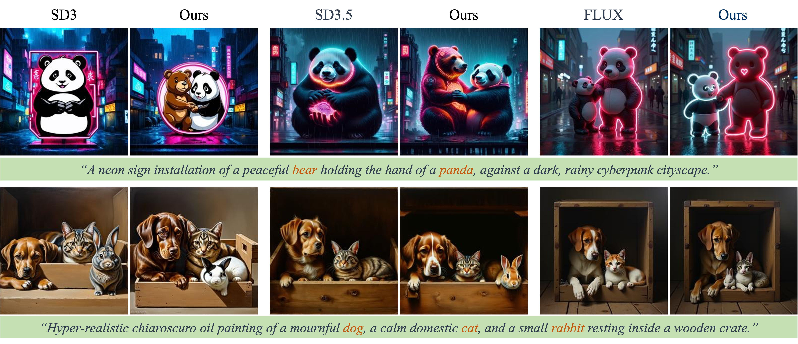

# Enhancing MMDiT-Based Text-to-Image Models for Similar Subject Generation

**[Tianyi Wei](https://scholar.google.com/citations?user=-wfXmM4AAAAJ&hl=en) &emsp; [Dongdong Chen](https://www.dongdongchen.bid/) &emsp; [Yifan Zhou](https://zhouyifan.net/) &emsp; [Xingang Pan](https://xingangpan.github.io)**

S-lab, Nanyang Technological University;  Microsoft GenAI

> This repository hosts the official PyTorch implementation of the paper: "**Enhancing MMDiT-Based Text-to-Image Models for Similar Subject Generation**".

Our approach can effectively mitigate the subject neglect or mixing issues suffered by MMDiT-based text-to-image models for similar subject generation.

