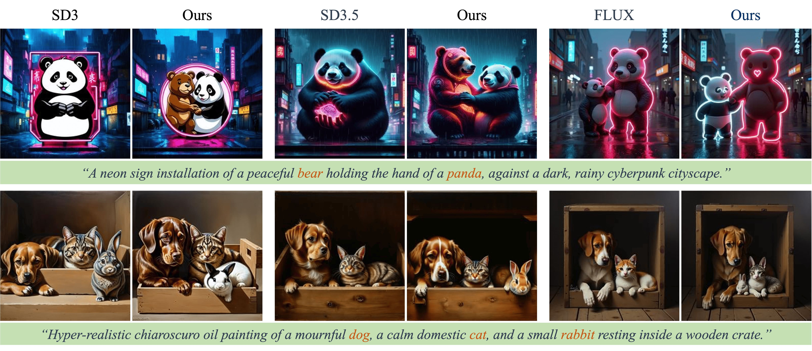

<div align="center">

<h1>Enhancing MMDiT-Based Text-to-Image Models for Similar Subject Generation (TPAMI 2026)</h1>
<a href="https://arxiv.org/abs/2411.18301"></a>
<a href="https://wtybest.github.io/projects/EnMMDiT/"></a>

**[Tianyi Wei](https://wtybest.github.io) &emsp; [Dongdong Chen](https://www.dongdongchen.bid/) &emsp; [Yifan Zhou](https://zhouyifan.net/) &emsp; [Xingang Pan](https://xingangpan.github.io)**

S-lab, Nanyang Technological University;  Microsoft GenAI

> This repository hosts the official PyTorch implementation of the paper: "**Enhancing MMDiT-Based Text-to-Image Models for Similar Subject Generation**".

Our approach can effectively mitigate the subject neglect or mixing issues suffered by MMDiT-based text-to-image models for similar subject generation.


</div>

## Getting Started
### Prerequisites
```bash
$ conda create -n enmmdit python=3.10
$ conda activate enmmdit
$ pip install torch==2.5.1+cu121 torchvision==0.20.1+cu121 --index-url https://download.pytorch.org/whl/cu121
$ pip install diffusers==0.31.0 transformers==4.46.2
$ pip install opencv-python sentencepiece protobuf accelerate
```

### Enhancing MMDiT
```bash
$ python3 methods/sd3/enmmdit_sd3.py --use_tea_loss --use_so_loss # For SD3
$ python3 methods/sd3point5/enmmdit_sd3point5.py --use_tea_loss --use_so_loss #For SD3.5
$ python3 methods/flux/enmmdit_flux.py #For FLUX
```

#### Notes on Key Arguments and Parameters
- `--use_tea_loss`: Enable Text Encoder Alignment Loss.
- `--use_so_loss`: Enable Subject Overlap Loss.
- `derive_restrict_mask`: Enable Overlap Online Detection and Back-to-Start Sampling Strategy.

## Citation

If you find our work useful for your research, please consider citing the following papers :)

```
@article{wei2026enmmdit,
  title={Enhancing MMDiT-Based Text-to-Image Models for Similar Subject Generation},
  author={Wei, Tianyi and Chen, Dongdong and Zhou, yifan and Pan, Xingang},
  journal={IEEE Transactions on Pattern Analysis and Machine Intelligence},
  year={2026}
}
```
